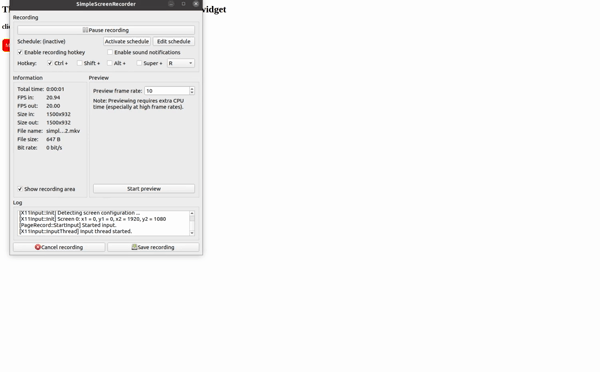

# @mohsen007/react-goftino

> A React component that wraps the [Goftino](https://www.goftino.com) live-chat widget — contact form, live chat, and help center — with a typed, event-driven API.

[](https://www.npmjs.com/package/@mohsen007/react-goftino)
[](https://bundlephobia.com/package/@mohsen007/react-goftino)


Published on npm and used in production. Zero runtime dependencies (React is a peer dependency only), fully typed, tested via CI across Node 10/12/14 on Ubuntu, Windows, and macOS.

## Installation

    npm i @mohsen007/react-goftino

or

    yarn add @mohsen007/react-goftino

## Quick Start

```js
import React from 'react';
import ReactDOM from 'react-dom';
import { GoftinoSnippet } from '@mohsen007/react-goftino';

const GOFTINO_KEY = 'your goftino embed key';

const App = () => (
  <GoftinoSnippet
    goftinoKey={GOFTINO_KEY}
    onReady={() => window.Goftino.open()}
  />
);

ReactDOM.render(<App />, document.getElementById('#app'));
```

## Events

| Event | Fires when |
|---|---|
| `onReady` | The widget script has loaded and is ready |
| `onOpen` | The chat widget opens |
| `onClose` | The chat widget closes |
| `onSendMessage` | The user sends a message (type + content available) |
| `onGetMessage` | A new message arrives from an operator |

## API Methods

All methods below are exposed on the global `window.Goftino` object and should only be called inside `onReady`:

- `setUser` / `getUser` — sync logged-in user info with Goftino
- `setWidget` — customize widget appearance (e.g. hide the default icon)
- `getUserId` / `setUserId` / `unsetUserId` — persist a conversation across browsers/devices
- `sendMessage` — programmatically send a message to the user
- `open` / `close` / `toggle` — control widget visibility

```js
onReady={() => {
  window.Goftino.setUser(...);
  window.Goftino.open();
}}
```

## Custom Widget Example

Hide the default widget icon and drive it entirely with your own UI:



See the [full example](https://github.com/moh3n007/react-goftino-snippet/tree/master/example) for the complete implementation.

## Tech Stack

- TypeScript, built with [tsdx](https://github.com/jaredpalmer/tsdx)
- CI: GitHub Actions, tested on Node 10/12/14 × Ubuntu/Windows/macOS
- Bundle size tracked via [size-limit](https://github.com/ai/size-limit)

## License

MIT
